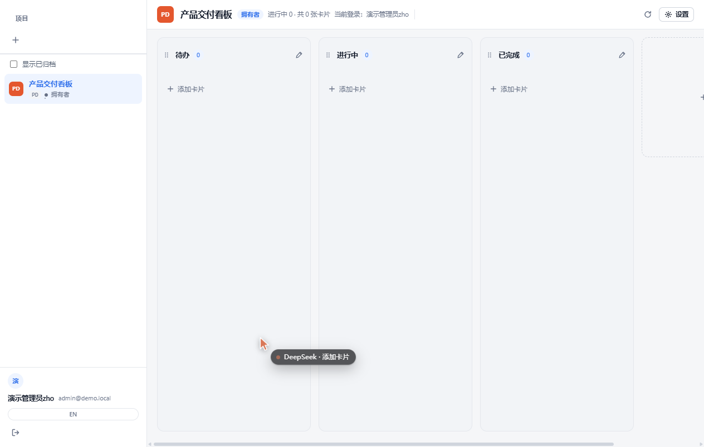
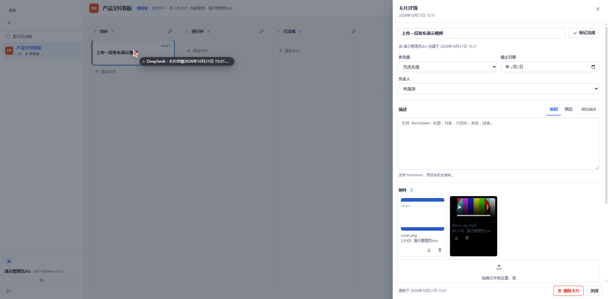

# KanWeave · 织板

**English** | [简体中文](README.md)

[](https://github.com/Yeezone/kanweave/actions/workflows/ci.yml)
[](LICENSE)
[](https://nodejs.org)

A self-hostable project-management product that also installs as a **DeepSeek Harness** plugin. Projects → lists → cards, with images and videos attached to cards, Markdown comments, DingTalk QR sign-in, per-project roles and invite links, and live board updates while several people work at once.

Zero runtime npm dependencies: the database is Node's built-in `node:sqlite`, HTTP is `node:http`, and the build output is a handful of `.js` files — copy them to a server and run `node lib/standalone.js`.



## Features

- **Projects / lists / cards** — custom columns per project, drag-and-drop between lists, per-project card numbers (`LAUNCH-12`), completion state.
- **Card detail** — priority, due date, assignee, Markdown description with safe preview, comments.
- **Media attachments** — images, video, audio, PDF, Office and archive files; drag or paste to upload, chunked continuation; video streams with HTTP `Range` so seeking works.
- **Live collaboration** — Server-Sent Events push board revisions and presence ("N people viewing"); automatic fallback to polling.
- **Accounts** — email + password, DingTalk QR login (enterprise internal app, OAuth2, bound on `(corpId, unionId)`), and self-registration through invite links.
- **Roles** — owner / admin / member / viewer per project; admins manage members, only owners transfer or delete a project.
- **Two shapes** — standalone website and a DeepSeek Harness sidebar panel that renders the same SPA and can point at one shared cloud space.



## Quick start (one minute)

Requires Node.js 24+ (or 22.19+) and pnpm.

```bash
git clone https://github.com/<your-account>/kanweave.git
cd kanweave
pnpm install
pnpm build
pnpm start            # http://localhost:4280/kanweave/ui/
```

The first visit asks you to create the initial administrator. Data lives in `./.data` (override with `KW_DATA_DIR`).

Prefer containers?

```bash
docker build -t kanweave .
docker run -d --name kanweave -p 4280:4280 -v kanweave-data:/data kanweave
```

Even the build is optional: grab `kanweave-<version>-standalone.zip` from
[Releases](https://github.com/Yeezone/kanweave/releases), unzip it and run `node lib/standalone.js`
(the bundle already ships `lib/` and `public/`, so no `pnpm install` needed).

## Deploy for a team (one shared space in the cloud)

Target shape: **one cloud server + one domain**, every device opens the same board, and the DSH plugin points at it too.

```bash
cp .env.example .env      # KW_PUBLIC_URL, DingTalk app credentials, KW_DATA_DIR
docker compose up -d --build
sudo cp deploy/Caddyfile /etc/caddy/Caddyfile && sudo systemctl reload caddy   # automatic HTTPS
```

On the plugin side, one small file connects the sidebar panel to the cloud:

```json
// ~/.dsh/kanweave/cloud.json
{ "url": "https://pm.example.com" }
```

Full guides:

- [docs/deploy-cloud.en.md](docs/deploy-cloud.en.md) — Docker deployment (recommended)
- [docs/deploy-cloud.md](docs/deploy-cloud.md) — same guide in Chinese

## Install as a DeepSeek Harness plugin

```bash
# Option 1: helper script (edits the profile package.json + bundles, then restart DSH)
node scripts/install-dsh-plugin.mjs --profile desktop

# Option 2: CLI
dsh plugin --profile desktop add link:E:/Projects/ProjectEdit   # use your own repo path
```

After restarting DeepSeek Harness a **织板 / KanWeave** entry appears in the sidebar; the panel hosts the complete board. Uninstall with `node scripts/install-dsh-plugin.mjs --profile desktop --remove`.

By default the plugin stores data on the local machine (`~/.dsh/kanweave`). With `cloud.json` it proxies to the shared deployment instead and keeps nothing locally — see section 4 of the deployment guide.

## Enabling DingTalk QR sign-in

The button appears only when all three conditions hold:

1. **The server has credentials** — either `KW_DINGTALK_*` environment variables or a `dingtalk.json` inside the data directory (the file is friendlier for the desktop plugin, where the launcher makes env vars awkward).
2. **You actually reach a login screen** — in plugin mode KanWeave signs you in automatically as the local operator, so click **“Sign in as someone else” (bottom-left rail)**; the DingTalk button lives on that login screen.
3. **The redirect URL registered in the DingTalk console matches byte for byte** (scheme, port, path).

Helper script (plugin data dir defaults to `~/.dsh/kanweave`, standalone to `./.data`):

```bash
node scripts/set-dingtalk.mjs --status        # is it enabled right now?
node scripts/set-dingtalk.mjs --mock          # offline demo: button works, no DingTalk app needed (UI check only)
node scripts/set-dingtalk.mjs --clear         # switch it off
```

Real DingTalk (internal enterprise app; no review required, QR sign-in does not need publishing to the workbench):

```bash
node scripts/set-dingtalk.mjs \
  --app-key dingxxxxxxxxxxxx \
  --app-secret YOUR_APP_SECRET \
  --corp-id dingyyyyyyyyyyyy \
  --redirect-uri https://pm.example.com/kanweave/api/auth/dingtalk/callback
```

The script writes exactly this file (mode 0600; both the console names `appKey/appSecret` and the OAuth2 names `clientId/clientSecret` are accepted):

```json
{
  "appKey": "dingxxxxxxxxxxxx",
  "appSecret": "YOUR_APP_SECRET",
  "corpId": "dingyyyyyyyyyyyy",
  "redirectUri": "https://pm.example.com/kanweave/api/auth/dingtalk/callback"
}
```

> **Which redirect URL?** After the cloud deployment use `https://<domain>/kanweave/api/auth/dingtalk/callback` — a stable host that works from any device and any plugin instance (recommended).
> A local `http://127.0.0.1:<port>/kanweave/api/auth/dingtalk/callback` is also accepted by DingTalk (localhost is allowed), but the DSH port changes on every launch, so it is debug-only.
> Restart DeepSeek Harness (or the standalone process) after editing the file. Confirm with the `dingtalk` field of `GET /kanweave/api/health`; whether the button renders comes from `capabilities.dingtalkLogin` in `api/auth/state`.

## Configuration

| Variable | Default | Purpose |
| --- | --- | --- |
| `KW_PORT` / `KW_HOST` | `4280` / `127.0.0.1` | Standalone listener |
| `KW_DATA_DIR` | `./.data` (`~/.dsh/kanweave` in plugin mode) | SQLite + attachments |
| `KW_PUBLIC_URL` | empty | Public origin; an `https://` value marks the session cookie `Secure` |
| `KW_COOKIE_SECURE` | follows `KW_PUBLIC_URL` | Set `0` only for plain-HTTP demos |
| `KW_MAX_ATTACHMENT_BYTES` | `1 GiB` | Per-file ceiling (raise the proxy limit too) |
| `KW_ALLOW_REGISTRATION` | on | Self-service signup; disable to keep invite links only |
| `KW_CLOUD_URL` | empty | Plugin proxy target for a shared cloud deployment |
| `KW_DINGTALK_CLIENT_ID` / `_CLIENT_SECRET` / `_CORP_ID` / `_REDIRECT_URI` | empty | DingTalk QR sign-in |

See [.env.example](.env.example) for the full list.

## Permissions

| Action | Viewer | Member | Admin | Owner |
| --- | --- | --- | --- | --- |
| View projects and cards | ✅ | ✅ | ✅ | ✅ |
| Create/edit cards, comment, upload | ❌ | ✅ | ✅ | ✅ |
| Delete anyone's card / comment / attachment | ❌ | ❌ | ✅ | ✅ |
| Manage lists and project settings | ❌ | ❌ | ✅ | ✅ |
| Invite members and change roles | ❌ | ❌ | ✅ (cannot grant admin) | ✅ |
| Archive / delete / transfer project | ❌ | ❌ | ❌ | ✅ |

## Architecture

```
src/core/        protocol types, error codes, permission matrix, media types, Markdown (pure)
src/host/        HTTP routes, SQLite store, auth, DingTalk OAuth2, media, SSE, cloud proxy
src/client/      DeepSeek Harness panel (React; iframe around the same SPA)
src/standalone/  browser SPA (React, built into public/app.js)
public/          SPA shell (index.html + CSS)
```

- One codebase, two faces: the host plugin owns `/kanweave/*` HTTP and storage; the SPA depends only on `src/core`.
- The wire contract lives in `src/core/protocol.ts`; business failures are HTTP 200 with `{ok:false,error:{code,message}}`.
- Single-writer design: SQLite (WAL) plus a `media/` directory — backing up means copying those two things.

## Development

```bash
pnpm typecheck                 # zero errors
pnpm test                      # vitest: real-HTTP integration tests + pure unit tests
pnpm build                     # tsdown bundles lib/ + public/app.js, then checks the client artifact
node scripts/smoke.mjs         # smoke test against a real server
node scripts/check-client-bundle.mjs
```

Engineering rules: [AGENTS.md](AGENTS.md). Contributing: [CONTRIBUTING.md](CONTRIBUTING.md). Security: [SECURITY.md](SECURITY.md).

## Known limits

- Single instance, no replication or shared database; live events refetch the whole board (fine for hundreds of cards).
- DingTalk is used for sign-in only — no contact sync; no email notifications, Gantt charts or time tracking.
- Attachments live on local disk; object storage is not wired in.

## License

[Apache-2.0](LICENSE) © 2026 KanWeave contributors
